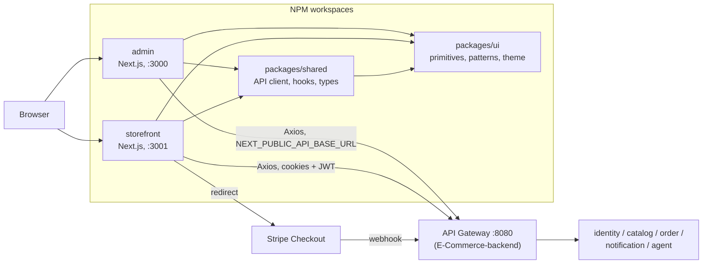

<div align="center">
  <h1>🛒 ShopSwift - Full-Stack E-Commerce Platform</h1>
  <p><strong>A modern, production-ready e-commerce solution with separate admin and storefront applications</strong></p>
  
  [](https://shopswift-admin.vercel.app)
  [](https://shopswift-storefront.vercel.app)
  
  
  
  
</div>

---

## 📋 Overview

ShopSwift is a comprehensive full-stack e-commerce platform built with modern web technologies. The project is organized as a **Monorepo** using NPM Workspaces, ensuring shared logic and components across all applications.

- **Admin Dashboard** - Complete product and order management system.
- **Customer Storefront** - High-performance, responsive shopping interface.
- **Shared Package** - Unified UI components, types, and API logic used by both applications.

Both applications are built with **Next.js 15**, **React 19**, and **TypeScript**, deployed on Vercel for optimal performance and scalability.

---

## ✨ Features

### 🎯 Admin Dashboard
- **Product Management**: Full CRUD operations with image uploads and category mapping.
- **Order Tracking**: Real-time management of order statuses and customer fulfillment.
- **Analytics**: Revenue metrics, top products, and customer growth tracking.
- **Bulk Operations**: Efficiently manage large product sets and category hierarchies.

### 🛍️ Customer Storefront
- **Dynamic Shopping**: Fast, responsive grid with advanced filtering and search.
- **Unified Cart**: Server-synchronized cart with optimistic local updates.
- **Checkout Flow**: Secure, UUID-idempotent checkout process with order confirmation.
- **Account Management**: Comprehensive profile, order history, and wishlist management.

### 📦 Shared Infrastructure
- **Design System**: Unified brand icons and UI primitives.
- **API Core**: Centralized Axios instance with standardized error handling.
- **Type Safety**: Shared TypeScript interfaces for products, orders, and users.

---

## 🏗️ Architecture



Both apps talk only to the API gateway. The backend lives in [../E-Commerce-backend](../E-Commerce-backend/README.md).

---

## 📁 Project Structure

```text
E-Commerce/
├── admin/                 # Admin dashboard (Next.js, Pages Router): products, orders, inventory,
│                          #   customers, analytics, marketing, shipping, returns, reviews, support
├── storefront/            # Customer storefront (Next.js, Pages Router): products, cart, checkout,
│                          #   account, payment, store
├── packages/
│   ├── shared/            # API client, hooks, types, utils, shared components
│   └── ui/                # Design system: primitives, patterns, theme
├── package.json           # Root workspace configuration
└── README.md
```

---

## 🚀 Getting Started

### Prerequisites
- Node.js 18.x or higher
- NPM 7+ (for Workspace support)

### Installation

1. **Clone and Install**
```bash
git clone https://github.com/yashrajoria/E-Commerce.git
cd E-Commerce
npm install
```

### Development

Run both applications concurrently:
```bash
npm run dev:both
```
Other scripts: `build:both`, `lint:both`, `typecheck`.

*   **Admin Dashboard:** [http://localhost:3000](http://localhost:3000)
*   **Storefront:** [http://localhost:3001](http://localhost:3001)

Backend must be running (see [../E-Commerce-backend](../E-Commerce-backend/README.md)). Point the apps at it via `.env.local` in each app:

| Variable | Purpose |
|----------|---------|
| `NEXT_PUBLIC_API_BASE_URL` | API gateway URL (e.g. `http://localhost:8080`) |
| `NEXT_PUBLIC_SITE_URL` | Public site URL |
| `NEXT_PUBLIC_DEFAULT_STORE_SLUG` | Default store (multi-tenant) |
| `NEXT_PUBLIC_CURRENCY`, `NEXT_PUBLIC_LOCALE` | Formatting |

Or run them individually:
```bash
npm run dev:admin
npm run dev:storefront
```

---

## 🛠️ Tech Stack

- **Frameworks:** [Next.js 15](https://nextjs.org/) (App Router & Pages Router)
- **UI Logic:** [React 19](https://react.dev/)
- **Styling:** [TailwindCSS](https://tailwindcss.com/)
- **Components:** [Radix UI](https://www.radix-ui.com/) & [Lucide Icons](https://lucide.dev/)
- **Data Fetching:** [TanStack Query v5](https://tanstack.com/query/latest)
- **State Management:** React Context API & Refs
- **Animations:** [Framer Motion](https://www.framer.com/motion/)

---

## 🌐 Live Deployments

- **Admin Dashboard:** [shopswift-admin.vercel.app](https://shopswift-admin.vercel.app)
- **Storefront:** [shopswift-storefront.vercel.app](https://shopswift-storefront.vercel.app)

---

## 👨‍💻 Author

**Yash Rajoria**
- GitHub: [@yashrajoria](https://github.com/yashrajoria)
- LinkedIn: [yashrajoria](https://www.linkedin.com/in/yashrajoria)

---

<div align="center">
  <p><strong>⭐ Star this repository if you find it helpful!</strong></p>
  <p>Made with ❤️ by Yash Rajoria</p>
</div>
