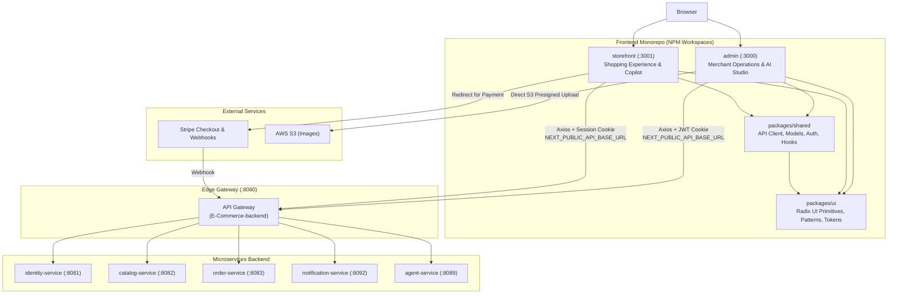

<div align="center">
  <h1>🛒 ShopSwift — Frontend Monorepo</h1>
  <p><strong>Enterprise-grade e-commerce frontend architecture powered by Next.js 15, React 19, TypeScript, Tailwind CSS, and Radix UI.</strong></p>
  
  [](https://shopswift-admin.vercel.app)
  [](https://shopswift-storefront.vercel.app)
  
  
  
  
  
  
</div>

---

## 📋 Monorepo Overview

This repository contains the complete frontend ecosystem for **ShopSwift**, structured as an **NPM Workspace Monorepo** for clean separation of concerns and unified code reuse:

- **[`storefront/`](./storefront/README.md)** (Port `3001`): Customer-facing e-commerce shopping experience featuring AI-powered visual search, live shopper copilot, subscribe & save, instant return portal, and guest checkout.
- **[`admin/`](./admin/README.md)** (Port `3000`): Full-featured merchant operations suite featuring AI Merchant Studio (copywriting, SEO, pricing), store credit & loyalty ledger, product/category management with S3 uploads, inventory & flash-sale waiting room controls, order fulfillment, Stripe refunds, and analytics.
- **[`packages/shared/`](./packages/shared/README.md)**: Shared API client (Axios with cookie/header token management), domain models, store credit types, auth utilities, and custom SWR/query hooks.
- **[`packages/ui/`](./packages/ui/README.md)**: Unified UI component library built on Radix UI primitives and Tailwind CSS design tokens (buttons, dialogs, data tables, metrics, form fields, price displays).

All backend communications flow through the **API Gateway** (`http://localhost:8080`) backed by the microservices platform in [../E-Commerce-backend](../E-Commerce-backend/README.md).

---

## ✨ Features Breakdown

### 🛍️ Customer Storefront (`storefront/`)
- **Multimodal Visual Search & "Shop the Look"**: Integrated camera modal and image uploader that computes visual similarity against catalog products to find exact or matching styles.
- **AI Personal Shopper Copilot**: Interactive conversational assistant with real-time streaming guidance (`/api/shopper/stream`), product suggestions, and basket curation.
- **Real-Time Stock Urgency & Live Social Proof**: Dynamic viewer badges and stock threshold notifications on product cards and detail pages to enhance conversion.
- **Self-Service Instant Return & Exchange Portal**: Frictionless customer return modal with immediate **+£5 bonus store credit** incentive to reduce cash refunds.
- **Subscribe & Save Replenishment Engine**: Flexible subscription selector (weekly, bi-weekly, monthly, quarterly) offering a 15% discount, managed via a dedicated account dashboard.
- **Collaborative Cart & "Shop Together"**: Shareable shopping sessions with base64 encoded URL hydration, enabling friends to co-browse and build carts together.
- **Frictionless Guest Checkout**: Fast checkout path (`POST /auth/guest`) allowing shoppers to place orders without creating a permanent account upfront.
- **Store Credit Balance & Checkout Allocation**: Live customer credit balance display, transaction history ledger, and split-tender payment allocation (100% credit or credit + Stripe).
- **Responsive Dynamic Catalog**: Category navigation, faceted search, price filters, sorting, and server-synchronized shopping cart.

### 🎯 Merchant Admin Dashboard (`admin/`)
- **AI Merchant Studio (`AIMerchantStudioModal.tsx`)**:
  - **AI Copywriting**: Generates compelling product titles, bullet points, and descriptions tailored to brand voice.
  - **AI SEO Optimization**: Suggests search-optimized meta titles, meta descriptions, and keyword tags.
  - **Smart Dynamic Pricing**: Calculates competitive pricing, margin elasticity, and promotional discounts.
- **Store Credit & Loyalty Management**: Search customer accounts, view ledger histories, and grant/adjust credit with compulsory audit notes and reasons.
- **Product & Category Management**: Comprehensive catalog editor with multi-image S3 upload presigning, category hierarchies, and inventory link.
- **Inventory & Flash Sale Controls**: Real-time stock counts, reorder alerts, and controls for the Redis FairPass flash-sale waiting room.
- **Order Fulfillment & Stripe Refunds**: Lifecycle tracking for pending, paid, shipped, delivered, and cancelled orders; built-in **Stripe refund processing** (full or partial) with automatic restock.
- **Customer Intelligence**: Server-side customer search (by name, email, phone), role filtering (admin, customer, guest), and spending history.
- **Marketing & Promotions**: Coupon engine supporting percentage and fixed discounts, expiration dates, and usage limits.
- **Analytics & Reporting**: Interactive revenue dashboards, average order value (AOV), sales distribution, and customer acquisition metrics.
- **Customer Support, Reviews & Activity Logs**: In-app support ticket handling, customer review moderation, and chronological administrative audit logs.

### 📦 Shared Packages
- **`@ecommerce/shared`**: Centralized Axios API client, standard error formatting, session/cookie handling, route constants (`apiRoutes.ts`), and shared TypeScript interfaces.
- **`@ecommerce/ui`**: Radix UI primitive components (`Dialog`, `Popover`, `Select`, `Tabs`, `Switch`, `Tooltip`, `Card`, `Button`, `Input`) and reusable business patterns (`DataTable`, `MetricDisplay`, `PriceDisplay`, `FormField`, `StateDisplays`).

---

## 🏗️ Architecture



---

## 📁 Project Structure

```text
E-Commerce/
├── admin/                         # Admin dashboard application (Port :3000)
│   ├── components/                # Admin UI components (AI Studio, Dashboard, Orders, etc.)
│   ├── hooks/                     # Admin data hooks (useStoreCredit, useOrders, useProducts)
│   ├── pages/                     # Pages Router routes (dashboard, products, orders, store-credit)
│   ├── tests/                     # Vitest smoke and unit test suites
│   └── package.json               # Admin workspace package config
│
├── storefront/                    # Customer storefront application (Port :3001)
│   ├── src/components/            # Storefront components (visual search, urgency, copilot)
│   ├── src/context/               # React Context providers (CartContext, AuthContext)
│   ├── src/hooks/                 # Storefront custom hooks
│   ├── src/pages/                 # Pages Router routes (catalog, cart, checkout, account)
│   └── package.json               # Storefront workspace package config
│
├── packages/
│   ├── shared/                    # Core SDK & API library
│   │   ├── src/api/               # Axios client, auth helpers, route definitions
│   │   ├── src/types/             # TypeScript contracts (models, storeCredit, common)
│   │   └── package.json           # @ecommerce/shared package config
│   │
│   └── ui/                        # UI Design System
│       ├── src/primitives/        # Base Radix UI wrapped components
│       ├── src/patterns/          # Complex patterns (data-table, metrics, forms)
│       ├── src/theme/             # Theme tokens and styling utilities
│       └── package.json           # @ecommerce/ui package config
│
├── package.json                   # Root monorepo workspace configuration
├── tsconfig.json                  # Root TypeScript build and path configuration
└── README.md                      # Frontend documentation (this file)
```

---

## 🚀 Getting Started

### Prerequisites
- **Node.js** v18.x or v20.x
- **NPM** v9+ (with NPM Workspaces support)
- **Backend running** on `http://localhost:8080` (see [../E-Commerce-backend/README.md](../E-Commerce-backend/README.md))

### Installation
```bash
git clone https://github.com/yashrajoria/ShopSwift.git
cd ShopSwift/E-Commerce
npm install
```

### Development Scripts

Run both applications concurrently:
```bash
npm run dev:both
```
- **Admin Dashboard**: [http://localhost:3000](http://localhost:3000)
- **Customer Storefront**: [http://localhost:3001](http://localhost:3001)

Or run individual applications:
```bash
# Run only Admin
npm run dev:admin

# Run only Storefront
npm run dev:storefront
```

### Building & Code Quality
```bash
# Type check all workspaces
npm run typecheck

# Lint both applications
npm run lint:both

# Production build for both applications
npm run build:both

# Run Admin smoke and unit tests
cd admin && npx vitest run

# Run Storefront unit tests
cd storefront && npm test
```

---

## ⚙️ Environment Variables

Create `.env.local` inside `admin/` and `storefront/` respectively:

### Storefront (`storefront/.env.local`)
| Variable | Description | Default / Example |
|:---|:---|:---|
| `NEXT_PUBLIC_API_BASE_URL` | API Gateway edge proxy URL | `http://localhost:8080` |
| `NEXT_PUBLIC_SITE_URL` | Public site domain | `http://localhost:3001` |
| `NEXT_PUBLIC_DEFAULT_STORE_SLUG` | Default multi-tenant store slug | `default` |
| `NEXT_PUBLIC_CURRENCY` | Default display currency | `GBP` or `USD` |
| `NEXT_PUBLIC_LOCALE` | Formatting locale | `en-GB` or `en-US` |

### Admin Dashboard (`admin/.env.local`)
| Variable | Description | Default / Example |
|:---|:---|:---|
| `NEXT_PUBLIC_API_BASE_URL` | API Gateway edge proxy URL | `http://localhost:8080` |
| `NEXT_PUBLIC_SITE_URL` | Admin portal domain | `http://localhost:3000` |
| `NEXT_PUBLIC_DEFAULT_STORE_SLUG` | Default store slug for operations | `default` |

---

## 🌐 Live Deployments

- **Merchant Admin Portal**: [shopswift-admin.vercel.app](https://shopswift-admin.vercel.app)
- **Customer Storefront**: [shopswift-storefront.vercel.app](https://shopswift-storefront.vercel.app)

---

## 👨‍💻 Author

**Yash Rajoria**
- GitHub: [@yashrajoria](https://github.com/yashrajoria)
- LinkedIn: [yashrajoria](https://www.linkedin.com/in/yashrajoria)

---

<div align="center">
  <p><strong>ShopSwift Frontend — Modern E-Commerce User Experiences</strong></p>
</div>
