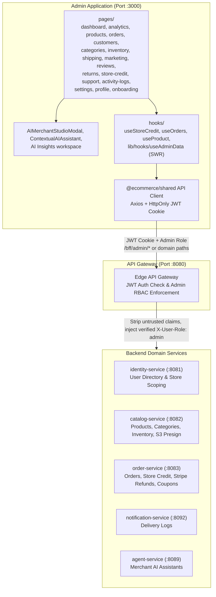

# 🛒 ShopSwift — Merchant Admin Dashboard

The **ShopSwift Admin Dashboard** is an enterprise-grade merchant operations portal built with **Next.js 15**, **React 19**, **TypeScript**, and **Radix UI**. It runs on port `3000` in the [ShopSwift Frontend Monorepo](../README.md).

Self-registration is disabled; sign-in requires an account with `role=admin`, seeded by `identity-service` via `ADMIN_EMAIL` and `ADMIN_PASSWORD` (default: `merchant.owner@shopswift-demo.test` / `Demo123!`).

---

## 🏛️ Architecture & Security



### RBAC & Mesh Security
- All admin routes require a valid JWT with `role=admin`.
- The gateway intercepts requests to `/bff/admin/*` and domain admin routes, validates the JWT, strips any client-supplied `X-User-*` headers, and injects verified `X-User-ID`, `X-User-Role: admin`, and `X-User-Email` headers.
- Internal service-to-service communication requires an `X-Internal-Service` token (`internalauth.Require()`), preventing direct external callers from bypassing perimeter controls.

---

## 🚀 Merchant Operations Modules

The sidebar (`components/dashboard/sidebar/navConfig.ts`) links to: Dashboard, Analytics, AI Insights, Products, Orders, Customers, Categories, Marketing, Reviews, Inventory, Shipping, Returns, Payments, Store Credit, Support, Activity Logs, Settings.

### 1. 🤖 AI Merchant Studio (`components/ai/AIMerchantStudioModal.tsx`)
Opened from product creation (`/products/add-product`) and editing (`/products/[id]/edit`):
- Generates a product title, markdown description, SEO meta text and a suggested price from a draft product name, then applies it to the product form via `onApply`.
- Generation is currently template-based on the client (simulated delay); it does not call an LLM service.

### 2. 🧠 AI Insights & Contextual Assistant
- **AI Insights (`/dashboard/ai-insights`)**: `AIInsightsWorkspace` (`components/dashboard/ai/`) with prompt composer, template cards, tool timeline, session drawer, diagnostics and incident triage banner. Backed by the `/api/agent/*` routes (`query`, `stream`, `tools`, `session/[session_id]`, `mutations`, `watchdog/scan`) and `/api/bff/admin/agent/*`.
- **`ContextualAIAssistant`**: floating page-aware copilot mounted from `_app.tsx`.

### 3. 💳 Store Credit (`/store-credit`)
- Look up a customer by user ID and inspect available/held balances.
- Grant and adjust credit with a required reason.
- Ledger view with entry types `grant`, `debit`, `hold`, `capture`, `release`, `refund`, plus a reconcile report modal.

### 4. 📦 Products (`/products`)
- Catalog list, `add-product`, and `[id]` / `[id]/edit` pages; bulk CSV upload (`BulkUpload`, `CSVPreviewTable`).
- Multi-image upload through presigned URLs (`/api/products/presign`, `/api/admin/products/presign`, `/api/products/[id]/images/presign`).

### 5. 🗂️ Categories (`/categories`)
- Category table with create, edit, delete and bulk upload (`/api/admin/categories/bulk`).

### 6. 📊 Inventory (`/inventory`)
- Stock levels with in-stock / low-stock / out-of-stock classification against each item's low-stock threshold.

### 7. 🧾 Orders (`/orders`, `/orders/[id]`)
- Filterable order list backed by `useAdminOrders`.
- The `[id]` detail page currently renders placeholder order data (status selector, tracking number display); it is not yet wired to the backend, and there is no refund modal.

### 8. 👥 Customers (`/customers`)
- Paged customer directory (`useAdminCustomers`) with search and filters, detail modal, and add-customer modal.

### 9. 🎟️ Marketing (`/marketing`)
- Coupon and campaign management (`useAdminCoupons`, `useAdminCampaigns`); coupon types include percentage, flat/fixed and free shipping, with usage counts.

### 10. 📈 Dashboard & Analytics (`/dashboard`, `/analytics`)
- KPI cards, revenue/orders charts, top products, recent activity, customer insights, revenue forecast, quick actions, and a store switcher (`StoreSwitcher`) in the page layout.

### 11. 🛠️ Operations
- **Shipping (`/shipping`)**: delivery KPI stats and carrier shipment cards.
- **Returns (`/returns`)**: return requests with refund KPI stats.
- **Reviews (`/reviews`)**: review moderation.
- **Support (`/support`)**: ticket queue with statuses `open`, `in-progress`, `resolved`, `closed`.
- **Activity Logs (`/activity-logs`)**: audit trail.

### 12. ⚙️ Settings, Profile & Onboarding
- **Settings (`/settings`)**: eight tabs: General, Billing & Plans, Team & Staff, Appearance, Email / SMTP, Shipping, Payments, Advanced.
- **Profile (`/profile`)**: Profile, Security, Notifications tabs.
- **Onboarding (`/onboarding`)**: multi-tenant store onboarding wizard (store identity, plan, theme color, confirmation).

---

## 📁 Source Layout

```text
admin/
├── components/
│   ├── ai/                    # AIMerchantStudioModal, ContextualAIAssistant
│   ├── admin/shared/          # DataStates, DemoDataBanner
│   ├── category/              # Category table, edit/delete, bulk upload
│   ├── customers/             # Customers table, filters, detail and add modals
│   ├── dashboard/             # KPI cards, charts/, sidebar/, ai/ (AI Insights workspace), StoreSwitcher
│   ├── landing/               # Marketing landing page sections and AuthModal
│   ├── layout/                # PageLayout
│   ├── orders/                # OrdersTable, OrdersFilters
│   ├── product-details/       # Image gallery, product info
│   ├── products/              # Product cards, filters, image upload, bulk CSV upload, edit modal
│   ├── settings/              # General, Billing, Team, Appearance, Notifications, Operations tabs
│   └── ui/                    # Local UI components
│
├── hooks/                     # useStoreCredit, useOrders, useProduct, useProductForm, useCategory, useBulkUpload, useUpload, useAIInsights
├── lib/                       # fetcher, hooks/useAdminData (SWR), db (pg), requireAdminApi, ssrAuth, AI helpers
├── pages/
│   ├── index.tsx              # Landing page with sign-in modal
│   ├── dashboard/             # index, ai-insights
│   ├── analytics/ activity-logs/ categories/ customers/ inventory/ marketing/
│   ├── onboarding/ profile/ returns/ reviews/ settings/ shipping/ store-credit/ support/
│   ├── products/              # index, add-product, [id], [id]/edit
│   ├── orders/                # index, [id]
│   └── api/                   # admin/* proxies, agent/*, bff/*, auth/*, products, categories, orders, uploads
├── src/pages/auth-demo.tsx    # Auth component demo
├── tests/                     # Vitest setup and page smoke tests (customers, store-credit)
├── package.json
└── README.md                  # This file
```

---

## 🚀 Running the Admin Dashboard

From the monorepo root (`E-Commerce/`):

```bash
# Install dependencies
npm install

# Start admin dashboard in development mode (runs on http://localhost:3000)
npm run dev:admin

# Build for production
npm run build:admin

# Run linting
npm run lint:admin

# Run smoke tests (Vitest, *.smoke.test.tsx)
npm run test:smoke --workspace admin
```

### Environment Configuration (`admin/.env.local`)

```env
# Server-only backend URL used by API routes / SSR (preferred)
API_BASE_URL=http://localhost:8080
# Browser-visible fallbacks (optional)
NEXT_PUBLIC_API_BASE_URL=http://localhost:8080
NEXT_PUBLIC_NEW_API_URL=http://localhost:8080/
NEXT_PUBLIC_BFF_URL=http://localhost:8088/
# Optional: default store ID for store-credit, DATABASE_URL / POSTGRES_URL for pg-backed routes
NEXT_PUBLIC_DEFAULT_STORE_ID=
```

---

## 👨‍💻 Author

**Yash Rajoria** — [GitHub](https://github.com/yashrajoria) · [LinkedIn](https://www.linkedin.com/in/yashrajoria)
