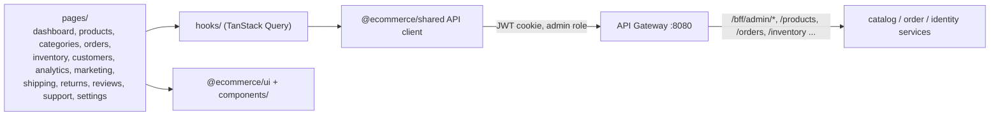

# ShopSwift Admin

Admin dashboard (Next.js 15 / React 19, Pages Router) in the [E-Commerce monorepo](../README.md). Runs on port `3000`. Requires an admin-role account (bootstrapped by identity-service via `ADMIN_EMAIL` / `ADMIN_PASSWORD`).

## Architecture



The gateway enforces admin RBAC; `/bff/admin/*` is a path prefix that the gateway forwards straight to domain services (no BFF process).

## Run

From the monorepo root (`E-Commerce/`):

```bash
npm install
npm run dev:admin        # http://localhost:3000
npm run build:admin
npm run lint:admin
npm run test:smoke --workspace admin   # vitest
```

Env vars and deployment: see the [root README](../README.md).
