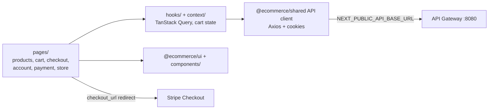

# ShopSwift Storefront

Customer-facing Next.js 15 / React 19 app (Pages Router) in the [E-Commerce monorepo](../README.md). Runs on port `3001`.

## Architecture



Checkout is idempotent (UUID `Idempotency-Key`). After `POST /cart/checkout` the page polls `GET /payment/status/by-order/{order_id}` until a Stripe `checkout_url` is ready.

## Layout

```text
src/
├── pages/       # routes: index, products, categories, cart, checkout, account, payment, store, auth
├── components/  # storefront components
├── context/     # React context providers
├── hooks/       # data hooks
├── lib/ utils/ types/ styles/
```

## Run

From the monorepo root (`E-Commerce/`):

```bash
npm install
npm run dev:storefront   # http://localhost:3001
npm run build:storefront
npm run lint:storefront
```

Needs the backend gateway reachable at `NEXT_PUBLIC_API_BASE_URL`. See the [root README](../README.md) for env vars and deployment (Vercel).
