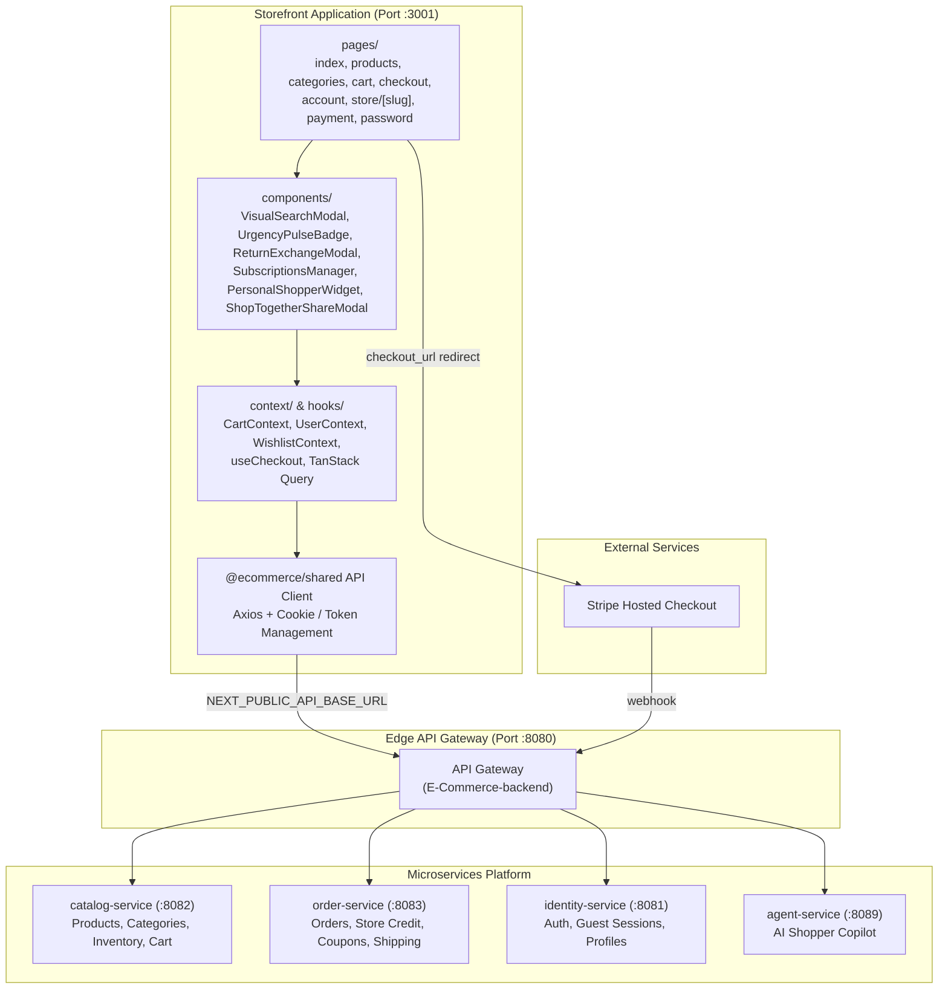
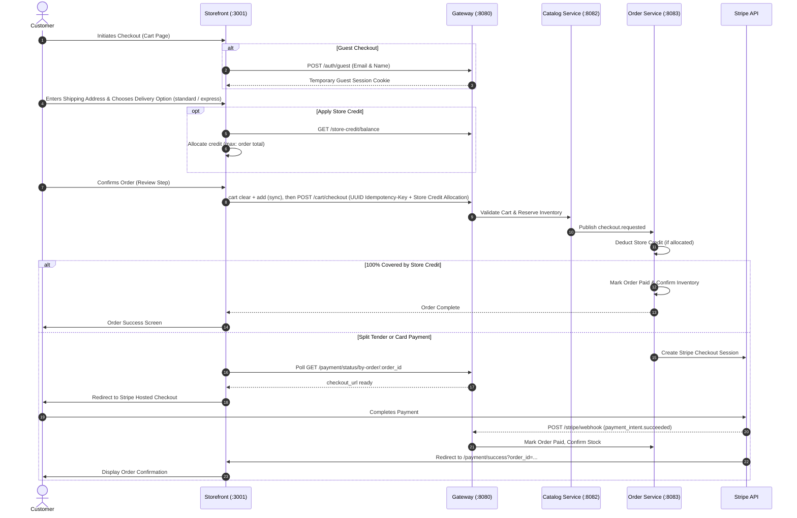

# 🛍️ ShopSwift — Customer Storefront

The **ShopSwift Storefront** is a high-performance, customer-facing web application built with **Next.js 15**, **React 19**, **TypeScript**, and **Tailwind CSS**. It runs on port `3001` within the [ShopSwift Frontend Monorepo](../README.md).

---

## 🏛️ Architecture



---

## ✨ Customer Experience Innovations

### 1. 📷 Visual Search & "Shop the Look"
- **Component**: `src/components/search/VisualSearchModal.tsx`
- **Route**: `src/pages/api/products/visual-search.ts`
- Customers upload an image or pick a curated style preset (e.g. *Nordic Minimalist Living & Decor*). The API route scores catalog products against the preset's aesthetic keywords and category hint and returns results with a similarity percentage and match reasons.
- Matching is keyword/preset based; the route does not run image-recognition on the uploaded photo.

### 2. ⚡ Stock Urgency & Social Proof Badge
- **Component**: `src/components/product/UrgencyPulseBadge.tsx` (rendered on the product detail page)
- Displays a low-stock warning (*"Only N left"*) and a *"N people viewing now"* pill.
- The viewer count is simulated client-side (seeded value updated on an interval); it is not real shopper telemetry.

### 3. 🔄 Return & Exchange Modal
- **Component**: `src/components/account/ReturnExchangeModal.tsx` (opened from order history)
- **Route**: `src/pages/api/user/returns/submit.ts`
- Customers choose a standard refund or an instant exchange. An instant exchange returns a store-credit voucher with a **+£5 bonus**.
- The route currently generates the return number, exchange coupon code and label locally; it does not call a backend service.

### 4. 🔁 Subscribe & Save
- **Components**: `src/components/product/SubscriptionPurchaseSelector.tsx`, `src/components/account/SubscriptionsManager.tsx`
- Product page selector toggles one-time purchase vs. subscription with a fixed **15% discount** and a delivery-frequency picker.
- The account "Subscriptions" tab lets shoppers change frequency (2/4/8 weeks), skip the next dispatch, pause/resume, or cancel. The manager runs on local sample state and is not yet persisted to a backend.

### 5. 👥 Cart Sharing ("Shop Together")
- **Component**: `src/components/cart/ShopTogetherShareModal.tsx`
- Encodes a minimal cart payload as a base64 `sharedCart` query parameter on `/cart`, with copy-to-clipboard, native share and WhatsApp shortcuts. The cart page (`pages/cart/index.tsx`) hydrates the shared items from that parameter. It is a share link, not live multi-user editing.

### 6. 🤖 AI Personal Shopper Copilot
- **Components**: `src/components/shopper/PersonalShopperWidget.tsx` (mounted globally in `_app.tsx`, hidden on `/checkout`), `BundleCardRenderer.tsx`; chat state in `useShopperChat.ts`
- **Routes**: `src/pages/api/shopper/stream.ts` (SSE proxy to backend `/shopper/query/stream`), `src/pages/api/shopper/query.ts` (non-streaming fallback)
- Conversational assistant powered by the backend agent service, with streamed replies and bundle cards (coupons delivered with a bundle are saved to `localStorage`).

### 7. 💳 Store Credit Checkout & Split-Tender Payment
- **Components**: `src/components/account/StoreCredit.tsx`, `src/components/checkout/steps/StepReview.tsx`
- Full customer visibility into their store credit balance and immutable transaction ledger.
- At checkout review, customers can apply their store credit with a single click. If the credit covers 100% of the total, the order finalizes immediately without redirecting to Stripe; otherwise, split-tender handles credit deduction and redirects to Stripe for the remainder.

### 8. 🚀 Frictionless Guest Checkout
- **Components**: `src/components/checkout/steps/StepContact.tsx`, `src/components/checkout/useCheckout.ts`
- Buyers can checkout without a pre-existing account. `useCheckout` calls `guestAuth` (`src/lib/auth.ts`) to establish a temporary guest session; contact and shipping details are saved as a draft in `localStorage` between steps.

---

## 💳 Checkout & Payment Flow



---

## 📁 Source Layout

```text
storefront/
├── src/
│   ├── components/
│   │   ├── account/           # StoreCredit, SubscriptionsManager, ReturnExchangeModal, order-history, address-book, wishlist-items
│   │   ├── cart/              # ShopTogetherShareModal
│   │   ├── checkout/          # steps/ (StepContact, StepShipping, StepDelivery, StepReview), sections/, useCheckout
│   │   ├── common/            # cart-drawer, wishlist-drawer, login-modal, account-dropdown, auth/, cards/ (product card variants)
│   │   ├── layout/            # header, footer, mega-menu, brand-logo, floating-action-button
│   │   ├── product/           # UrgencyPulseBadge, SubscriptionPurchaseSelector, image gallery, reviews, related products
│   │   ├── search/            # VisualSearchModal, search-filters, CatalogPagination
│   │   ├── sections/          # Homepage hero, categories, collections, featured products
│   │   ├── shopper/           # PersonalShopperWidget, BundleCardRenderer, useShopperChat
│   │   ├── providers/         # theme-provider
│   │   └── ui/                # Local Radix/shadcn-style primitives
│   │
│   ├── context/               # CartContext, UserContext, WishlistContext providers
│   ├── hooks/                 # useProducts, useCategories, useOrders, useProductSearchState, use-toast
│   ├── lib/                   # auth, order, user, ssrProducts, requireUserApi, types, utils
│   ├── utils/axiosInstance.ts # Axios client
│   └── pages/
│       ├── index.tsx          # Homepage with hero, featured collections, promotions
│       ├── products/
│       │   ├── index.tsx      # Product catalog grid with filters, sorting, search
│       │   └── [id].tsx       # Product detail page (PDP) with urgency badge & subscription selector
│       ├── categories/index.tsx # Category listing
│       ├── cart/index.tsx     # Full cart overview with Shop Together sharing and shared-cart hydration
│       ├── checkout/index.tsx # 4-step checkout wizard (Contact, Shipping, Delivery, Review)
│       ├── account/index.tsx  # Tabs: profile, orders, subscriptions, wishlist, addresses, payment, credit, settings
│       ├── password/          # request-reset and reset pages
│       ├── payment/success/   # Payment confirmation screen & order polling
│       ├── store/[slug]/      # Multi-tenant merchant store page (hero + public product grid, SSR)
│       ├── auth-demo.tsx      # Dev demo of the shared Login/Register components
│       └── api/               # Next.js API routes: user/* proxies (auth, cart, categories, orders, payment,
│                              #   products, profile, promotions, store-credit, returns/submit), products,
│                              #   products/visual-search, shopper/{stream,query}, og, revalidate
│
├── package.json
└── README.md                  # This file
```

---

## 🚀 Running the Storefront

From the monorepo root (`E-Commerce/`):

```bash
# Install dependencies
npm install

# Start storefront in development mode (runs on http://localhost:3001)
npm run dev:storefront

# Build for production
npm run build:storefront

# Run linting
npm run lint:storefront
```

### Environment Configuration (`storefront/.env.local`)

```env
NEXT_PUBLIC_API_BASE_URL=http://localhost:8080
NEXT_PUBLIC_SITE_URL=http://localhost:3001
NEXT_PUBLIC_DEFAULT_STORE_SLUG=default
NEXT_PUBLIC_CURRENCY=GBP
NEXT_PUBLIC_LOCALE=en-GB
# Server-only: backend URL for API routes (takes precedence over NEXT_PUBLIC_API_BASE_URL)
API_BASE_URL=http://localhost:8080
# Optional: secret for /api/revalidate (ISR)
REVALIDATE_SECRET=
```

---

## 👨‍💻 Author

**Yash Rajoria** — [GitHub](https://github.com/yashrajoria) · [LinkedIn](https://www.linkedin.com/in/yashrajoria)
